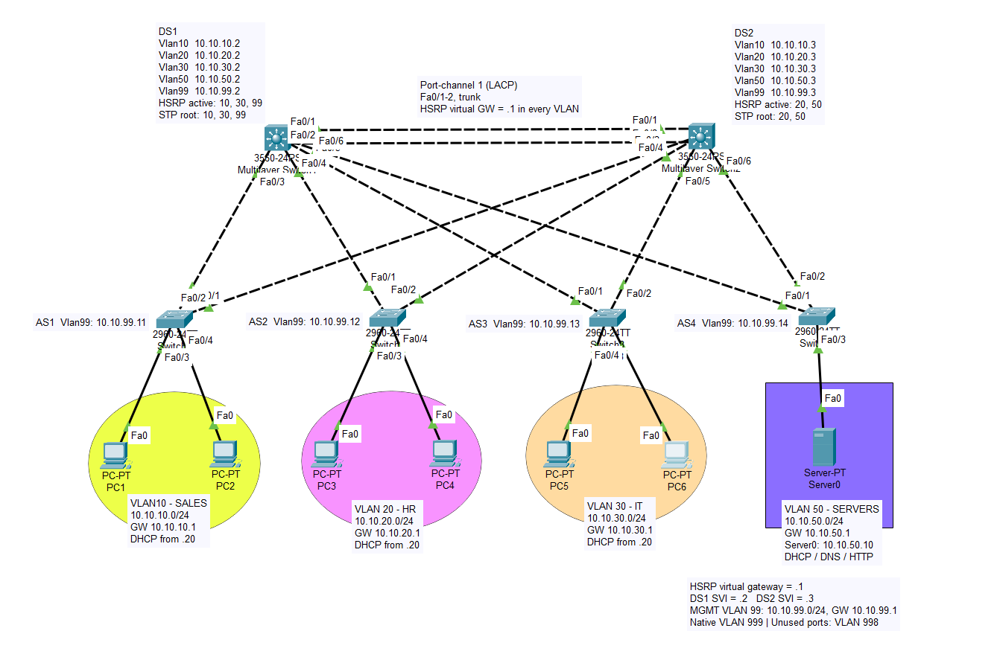

# Enterprise Campus Switching Lab (Cisco Packet Tracer)

A three-tier campus: two multilayer distribution switches, four access switches and a server block, with LACP EtherChannel,
HSRP gateway redundancy, Rapid-PVST+, DHCP relay and Layer 2 security.

## Concepts
| Concept | Implementation |
|---|---|
| EtherChannel | LACP Port-channel 1 between DS1 and DS2 (Fa0/1-2) |
| Rapid-PVST+ | One root per VLAN, aligned with the HSRP active gateway |
| HSRP | Virtual gateway `.1` in every VLAN, priority 110 and preempt on the active switch |
| DHCP relay | `ip helper-address 10.10.50.10` on the VLAN 10/20/30 SVIs; DHCP server in VLAN 50 |
| DHCP snooping | Access switches; uplinks trusted, edge ports untrusted, option 82 insertion off |
| Port security | Sticky MAC, maximum 1, violation restrict on edge ports |
| Root Guard / BPDU Guard | Root Guard on DS downlinks; PortFast + BPDU Guard on edge ports |
| Trunk hardening | Native VLAN 999, allowed VLAN list, DTP off (`nonegotiate`) |
| Management | VLAN 99 SVIs, enable secret, login banner, SSH login to an access switch |
| Unused ports | Shut down and placed in VLAN 998 |

## Addressing
| VLAN | Name | Subnet | Gateway | DS1 / DS2 SVI | HSRP active and STP root |
|---|---|---|---|---|---|
| 10 | SALES | 10.10.10.0/24 | .1 | .2 / .3 | DS1 |
| 20 | HR | 10.10.20.0/24 | .1 | .2 / .3 | DS2 |
| 30 | IT | 10.10.30.0/24 | .1 | .2 / .3 | DS1 |
| 50 | SERVERS | 10.10.50.0/24 | .1 | .2 / .3 | DS2 |
| 99 | MGMT | 10.10.99.0/24 | .1 | .2 / .3 | DS1 |

AS1 to AS4 management addresses: 10.10.99.11 to .14. Server0: 10.10.50.10 (DHCP, HTTP). VLAN 998 is unused ports, VLAN 999 is the native VLAN.

## Links
DS1 to DS2: Fa0/1-2 (EtherChannel). DS1 Fa0/3-6 and DS2 Fa0/3-6 to AS1-AS4: Fa0/1 goes to DS1, Fa0/2 to DS2 (AS1's labels overlap, but the configs treat both uplinks the same).

## Verification (real output from the lab)
| Check | Result | Evidence |
|---|---|---|
| EtherChannel | Po1 `SU`, Fa0/1 and Fa0/2 `P` on both switches | `images/ds1_etherchannel.png`, `images/ds2_etherchannel_rootguard.png` |
| Root Guard | DS2 logged a Root Guard block on Fa0/6 (VLAN 30) | `images/ds2_etherchannel_rootguard.png` |
| HSRP | DS1 active for 10, 30, 99; DS2 active for 20, 50; preempt on | `images/ds1_standby.png`, `images/ds2_standby.png` |
| STP roots | DS1 root for SALES, IT, MGMT; DS2 for HR, SERVERS | `images/ds1_stp_summary.png`, `images/ds2_stp_summary.png` |
| Load sharing | On AS1, Fa0/1 forwards VLANs 10, 30, 99 and Fa0/2 forwards 20, 50 | `images/as1_security_trunk.png` |
| DHCP snooping | Enabled for VLANs 10, 20, 30; uplinks trusted | `images/as1_security_trunk.png` |
| Port security | Fa0/3 secure-up, sticky, max 1, restrict | `images/as1_security_trunk.png` |
| Port-security violation | A second PC on AS1 Fa0/3 raised the violation count to 8 (last source `0090.21EB.6DA8`); the port stayed Secure-up and the PC's ping to the gateway had 100% loss | `images/portsec_violation.png`, `images/pc7_blocked_ping.png` |
| DHCP relay and routing | PC1 received 10.10.10.22 (gateway 10.10.10.1); pings to the server and a VLAN 20 host succeed, TTL 127 | `images/pc1_dhcp_ping.png` |
| HTTP | Web page loads from 10.10.50.10 | `images/pc1_http.png` |
| Failover | With DS1 down, DS2 is active for all five VLANs and root for all of them | `images/ds2_failover.png` |
| Failback | After DS1 was restored, it is Active again for VLANs 10, 30 and 99 (preempt) and Standby for 20 and 50 | `images/ds1_failback_standby.png` |
| SSH management | PC2 (VLAN 10) logged in to AS1 at 10.10.99.11 over SSH, saw the login banner and reached privileged mode | `images/ssh_login_as1.png` |

## Design notes

### Why option 82 insertion is off on the access switches
DHCP snooping adds Option 82 (relay agent information, which records the switch and port) to client DHCP requests by default, on any switch where snooping is enabled for the VLAN. In this design the access switches run snooping, while the distribution switches relay the request to the server in VLAN 50. A relay can drop a request that already carries the tag, so insertion is turned off on AS1 to AS4 with `no ip dhcp snooping information option`. Snooping itself still works: trusted ports and the binding table are unaffected.

### Why the HSRP active switch is also the STP root
For each VLAN, STP decides which links forward and HSRP decides which switch answers as the default gateway. If two different switches do those jobs, a frame travels to the STP root first and then crosses the inter-switch link to reach the gateway, which adds a hop. Giving both jobs to the same switch (DS1 for VLANs 10, 30 and 99, DS2 for VLANs 20 and 50) lets the frame reach the gateway directly. On AS1, Fa0/1 forwards VLANs 10, 30 and 99 (toward DS1) and Fa0/2 forwards VLANs 20 and 50 (toward DS2).

## Lessons learned
1. **Build the Port-channel first.** My member ports stayed stand-alone until I rebuilt the bundle in that order.
2. **Align HSRP and STP.** The switch that is the active gateway is also the root, so traffic takes the short path, and each access switch uses one uplink per VLAN group.
3. **Relay and snooping interact.** DHCP relay works across VLANs, and I switched option 82 insertion off on the access switches, because relay and snooping can conflict over it.
4. **Restrict mode keeps the port up.** An unknown device is dropped and each violation is counted, while the legitimate host keeps working.
5. **Failover leaves no blocked ports.** With DS1 down, the loop disappears and every VLAN forwards on DS2.

## Tools
Cisco Packet Tracer, Cisco IOS (2960 / 3560)
