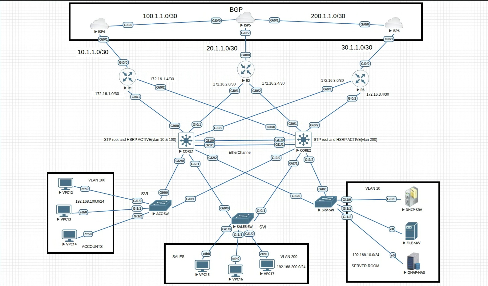

# Enterprise HA Network (EVE-NG)

A highly available enterprise network with three ISPs running eBGP, three PAT edge routers, dual Layer 3 core switches (HSRP + Rapid PVST), an LACP EtherChannel between the cores, and centralized DHCP.



## Highlights

- eBGP between three ISPs (AS 65004 / 65005 / 65006)
- Edge routers R1-R3 with PAT, static default routes and OSPF default-route origination (R1 primary exit, R2 and R3 backups)
- Dual core switches with SVIs, HSRP and deliberately placed STP roots (CORE1 for VLAN 10 and 100, CORE2 for VLAN 200)
- LACP EtherChannel (Po1) between the cores, with dual-homed access switches
- Centralized DHCP using `ip helper-address` on the SVIs
- ACLs to isolate Accounts from Sales

## Tools

EVE-NG, Cisco IOSv 15.6, Cisco IOSvL2 15.2, VPCS

## Repository

```
.
├── configs/
│   └── all-configs.txt
├── images/
├── BUILD_AND_VERIFY.md
└── README.md
```

Start with [BUILD_AND_VERIFY.md](BUILD_AND_VERIFY.md) for the cabling, build order and verification steps. All device configurations are in [configs/all-configs.txt](configs/all-configs.txt).


